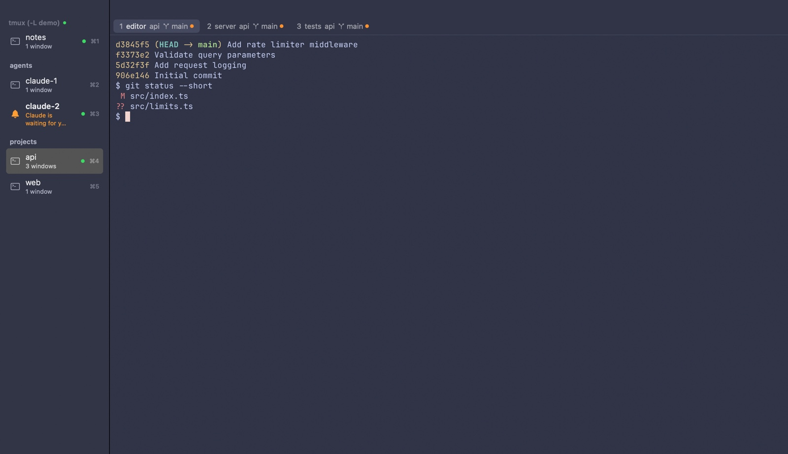
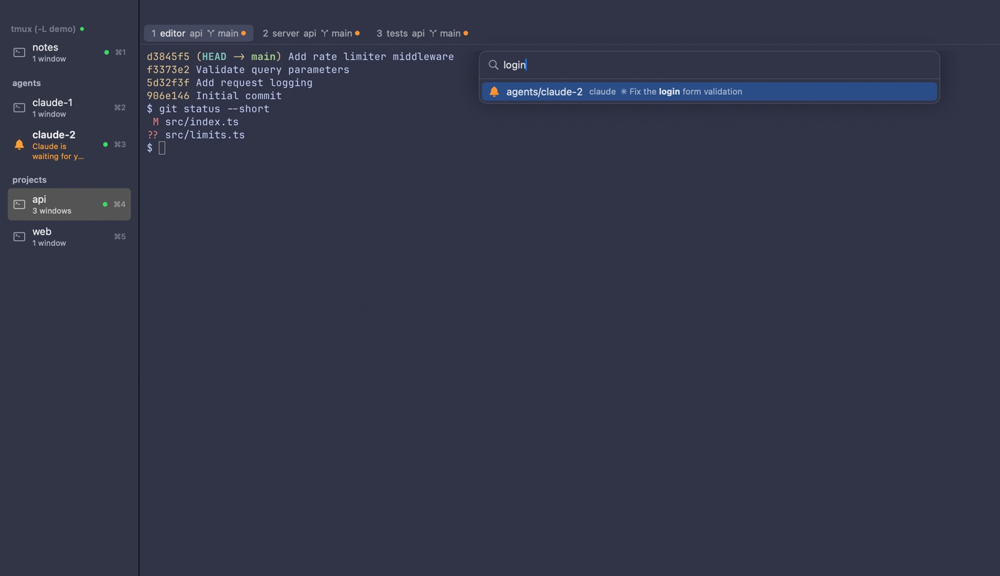

# dmucode

**A macOS terminal for tmux: your sessions in a sidebar, each one in a native Ghostty terminal.**



dmucode is a native macOS app built around a tmux server. The sidebar lists the server's sessions and updates live. The selected session runs in a terminal rendered by [libghostty](https://github.com/ghostty-org/ghostty), the engine of the Ghostty terminal, with your Ghostty fonts, theme and settings. The session's tmux windows are shown as tabs.

Sessions belong to tmux, not to the app. Quitting dmucode only detaches its clients, so your programs keep running. With tmux-resurrect, the sessions also come back after a reboot. This works well for many long-lived sessions, such as several AI coding agents side by side, where you want to see at a glance which one is waiting for you.

> **Status:** an early, personal project. It runs only on macOS, and you build it from source. It embeds libghostty through `ghostty.h`, which is Ghostty's internal API, not a stable one. Expect rough edges.

## Features

- **A config file.** `~/.config/dmucode/config`, in Ghostty's syntax, remaps the keyboard shortcuts, hides the title bar or the tabs, trims the sidebar, and reloads when saved.
- **Live session sidebar.** dmucode keeps a tmux control-mode connection, so new, renamed and closed sessions show up immediately, without polling.
- **Ghostty terminals.** Each session gets its own libghostty surface with your `~/.config/ghostty/config`: fonts, themes, background opacity and blur. Saving the config applies it right away.
- **Windows as tabs.** Each tab shows the directory of the window's active pane and, inside a git repository, the branch and whether there are changes, conflicts or unpushed commits.
- **Attention markers.** A session whose terminal rings the bell or sends a desktop notification (OSC 9/777) gets an orange bell and the notification's text, for example when Claude Code is waiting for input. The Dock icon shows how many sessions want attention.
- **⌘K palette.**
  - Fuzzy-find any session, window or pane. Panes are found by their title too, where Claude Code writes the topic of its conversation.
  - With [sesh](https://github.com/joshmedeski/sesh) installed, its configured sessions that aren't running are found too, and Return starts one: sesh creates the session in its directory and runs its startup command.
  - Start the line with `:` to run a tmux command.
- **Your order, remembered.**
  - Drag sessions into any order and into groups.
  - Sessions named `group/name` file themselves under `group`.
  - The order is remembered by session name, so it survives restarts and reboots.
- **Restore after reboot.** If tmux-resurrect has a save and no tmux server is running, dmucode starts the server so that tmux-continuum restores your sessions.



## Requirements

- An Apple silicon Mac with macOS 14 or later.
- [tmux](https://github.com/tmux/tmux) 3.2 or later, which has the control-mode features dmucode relies on (format subscriptions with `refresh-client -B`, client flags such as `no-output`). 3.6 or later is recommended. Only 3.8 is tested; nothing checks the versions in between. dmucode looks for `tmux` (and `git`, for the tabs' git status) in `/opt/homebrew/bin`, `/usr/local/bin`, `/opt/local/bin` (MacPorts), the Nix profiles (`~/.nix-profile/bin`, `/etc/profiles/per-user/$USER/bin`, `/run/current-system/sw/bin`, `/nix/var/nix/profiles/default/bin`) and `/usr/bin`, then in the `PATH` it was started with. If it finds no tmux there, it asks your login shell (`$SHELL -l -c 'command -v tmux'`). Set `DMUCODE_TMUX` to use another one.
- To build from source: Xcode 16 or later (Swift 6), and [Zig](https://ziglang.org) **0.16.x** for libghostty. Ghostty needs this exact minor version, so Homebrew's current `zig` won't do; install `zig@0.16`.

## Installation

### Homebrew

```bash
brew install --cask dmuko/tap/dmucode
```

This installs tmux too. `brew upgrade --cask dmucode` updates the app; your sessions keep running in tmux meanwhile. Releases are signed with a Developer ID and notarized, and the DMGs are also on the [releases page](https://github.com/dmuko/dmucode/releases).

### From source

Building libghostty takes about five minutes the first time.

```bash
brew install tmux zig@0.16

git clone --recurse-submodules https://github.com/dmuko/dmucode.git
cd dmucode
./scripts/build-ghosttykit.sh   # libghostty → vendor/ghostty/macos/GhosttyKit.xcframework
./scripts/build-app.sh          # → build/dmucode.app

cp -R build/dmucode.app /Applications/
open /Applications/dmucode.app
```

`build-ghosttykit.sh` finds Homebrew's `zig@0.16` by itself; to use another Zig, set `ZIG=/path/to/zig`. The app is signed ad hoc, which is enough to run it on the machine that built it.

**Updating a source build:**

1. Run `git pull` and `git submodule update`.
2. If the `vendor/ghostty` submodule moved, run `build-ghosttykit.sh` again.
3. Run `build-app.sh`, copy the app again and relaunch. Your sessions keep running in tmux in the meantime.

## Getting started

1. **Launch dmucode.** The sidebar shows the sessions of your default tmux server. If there are none, press **⌘N** to create one; it starts in your home directory.
2. **Click a session** to attach to it. Inside the terminal it is plain tmux: your prefix key, splits and key bindings work as usual.
3. **Switch** with ⌘1…⌘9, ⌘↑ / ⌘↓, or **⌘K** and a few letters of a session, window or pane name. ⌘K then Return goes back to the previous session.
4. **Organize** the sidebar by dragging sessions. To create a group, click the folder button at the bottom of the sidebar, or create a session named `group/name`.
5. **Quit** whenever you like. Quitting only detaches, and the next launch shows the same sessions and selects the one you used last.

## Usage

### Sidebar

- **Row contents:** each row shows the session's name and its number of windows. A green dot means a terminal is attached to it: dmucode's own once you have opened the session, or one elsewhere. A gray dot means activity in a window, if you use `monitor-activity on` in tmux.
- **Live indicator:** the dot in the sidebar header is green while updates arrive live over control mode, and gray while dmucode polls because there is no session to connect to yet.
- **Context menu:** right-click a session for **Rename…**, **Move to Group** and **Kill Session…**. Right-click a group header for **Rename Group…** and **Remove Group**; removing a group keeps its sessions, ungrouped.
- **Dragging:**
  - Drag sessions to reorder them. Drop one under a group header to put it in that group, or above the first group to take it out.
  - Drag a group by its header to move it together with its sessions.
- **Remembered by name:** the order and groups are stored by session name, separately for each tmux socket.
  - A session that is killed and later created again with the same name returns to its place, for example after a reboot.
  - New names are added at the end of the ungrouped sessions, and renaming a session keeps its place.
- **Automatic groups:** a session named `group/name` files itself.
  - The first time dmucode sees it, the session goes to the end of the group `group` and is shown there as `name`. The group is created if needed, and an existing group matches regardless of case.
  - For example, `tmux new -s agents/claude-1` appears as `claude-1` under **agents**.
  - Renaming a session to a new prefix moves it to that group, and removing the prefix takes it out.
  - You can still drag such a session anywhere. Outside its group it shows its full name.

### Tabs

- **Contents:** the tabs are the tmux windows of the selected session. A tab shows the window's index and name, the directory of its active pane, and in a git repository:
  - the branch, or the commit when HEAD is detached
  - an orange dot for uncommitted changes
  - a red triangle for conflicts
  - ↑/↓ counts for commits ahead of or behind the upstream

  Hover over a tab for the full path and the counts.
- **Actions:** click a tab to select the window. The **+** button (⌘T) opens a new window in the current pane's directory. Right-click a tab for **Rename** and **Close Window**.
- **Sync with tmux:** switching windows inside tmux (`prefix n`, `prefix 3`…) moves the highlight too.

### The ⌘K palette

**Session mode (⌘K)** fuzzy-matches what you type against:

- session names
- window names and directories
- pane titles and programs. Programs such as Claude Code or nvim write their title into the pane; titles that are just the host name or a directory are skipped, and so are plain shells.

Return switches to the match: the session, and the window and pane when one of those matched. With an empty query, the sessions are listed by when you last used them, so ⌘K then Return toggles between the last two.

With sesh installed, the sessions in its config that aren't running are matched by name and directory too, marked with **+** and "sesh", and listed after the sessions (a few of them with an empty query). Return starts the session; see [sesh](#sesh).

**Command mode (`:` or ⌘:)** turns the palette into tmux's command prompt. Type `:` as the first character, or open it directly with **⌘:**.

- **Completion and help:** command names complete with Tab and ↑/↓, and the usage of the command you are typing is shown below the field.
- **Results:** output (for example `display -p '#{pane_id}'` or `list-windows`) and errors appear in the palette. A command without output closes it.
- **Target:** commands run as the active pane of the shown session, so commands without `-t` act on what you see.
- **History:** ↑/↓ recall earlier commands when no completions are shown.
- **Leaving:** ⌫ on an empty command line goes back to session search.

tmux's own `prefix :` still opens tmux's prompt inside the terminal.

### Attention markers

A session that wants attention gets an orange bell in the sidebar. This happens when:

- a bell rang in one of its windows, or
- a program in it sent a desktop notification (OSC 9 or OSC 777). The notification's text is shown under the session's name.

Showing the session clears the marker. Nothing is marked for the session you are looking at. The Dock icon shows the number of sessions that want attention.

For Claude Code, see [Claude Code notifications](#claude-code-notifications).

### Keyboard shortcuts

The action names are for remapping in the [config file](#dmucode).

| Shortcut | Action | Name |
|---|---|---|
| ⌘N | New session | `new_session` |
| ⌘R | Rename the selected session | `rename_session` |
| | Kill the selected session (asks first) | `kill_session` |
| ⌘1 … ⌘9 | Go to the session at that position in the sidebar | `goto_session:1` … `goto_session:9` |
| ⌘↓ / ⌘↑ | Next / previous session | `next_session` / `previous_session` |
| ⌘K | Palette: find a session, window or pane | `switch_session` |
| ⌘: | Palette in command mode (tmux command) | `tmux_command` |
| ⌘T | New tmux window (tab) in the current pane's directory | `new_tab` |
| ⌘W | Close the current tmux window (asks first) | `close_tab` |
| ⌥⌘R | Rename the current tmux window | `rename_tab` |
| ⌘→ / ⌘← | Next / previous tab | `next_tab` / `previous_tab` |
| ⌥⌘1 … ⌥⌘9 | Go to the tab at that position (counted from the left, not tmux's index) | `goto_tab:1` … `goto_tab:9` |
| ⌃⌘S | Show / hide the sidebar | `toggle_sidebar` |
| ⌃⌘F | Native full screen | `toggle_fullscreen` |
| ⌘M | Minimize | `minimize` |
| ⇧⌘, | Reload the dmucode and Ghostty configs | `reload_config` |
| ⌘C / ⌘V | Copy / paste | `copy` / `paste` |
| ⌘A | Select all | `select_all` |
| ⌘H / ⌘Q | Hide / quit dmucode | `hide` / `quit` |

⌘K replaces Ghostty's default `clear_screen` binding. In tmux, `clear` or `C-l` clears the pane.

## Configuration

### dmucode

dmucode reads `~/.config/dmucode/config` (`$XDG_CONFIG_HOME/dmucode/config` if that is set, or the file named by `DMUCODE_CONFIG`). The syntax is Ghostty's: one `key = value` per line, `#` starts a comment. The file is optional. Saving it applies the changes, as does ⇧⌘, (*Reload Config*), and lines with errors are skipped and listed in a sheet while the rest applies.

```
title-bar = false
tabs = auto
sidebar-shortcuts = false
```

| Option | Values | Default | Effect |
|---|---|---|---|
| `title-bar` | `true`, `false` | `true` | `false` hides the title bar and the traffic lights, as Ghostty's `macos-titlebar-style = hidden`: the sidebar and the tabs start at the top of the window, which is dragged by its chrome. ⌘Q quits, ⌘M minimizes, ⌃⌘F goes full screen. |
| `tabs` | `always`, `auto`, `never` | `always` | When the session's windows are shown as tabs; `auto` shows them once there is more than one window. ⌘T, ⌘← / ⌘→ and ⌥⌘1…9 work either way. |
| `tab-git-status` | `true`, `false` | `true` | The branch and status on the tabs. `false` also stops running git. |
| `sidebar-window-count` | `true`, `false` | `true` | "3 windows" under each session's name. Notifications are shown there either way. |
| `sidebar-shortcuts` | `true`, `false` | `true` | The ⌘1 … ⌘9 hints on the sidebar rows. |

Booleans accept `true`/`false`, `yes`/`no`, `on`/`off` and `1`/`0`. A repeated option takes its last value.

`keybind` gives a shortcut to one of the actions listed under [Keyboard shortcuts](#keyboard-shortcuts):

```
# Free ⌘K for Ghostty's clear_screen and find sessions with ⌘⇧K instead.
keybind = cmd+shift+k=switch_session
keybind = cmd+k=unbind

# Sessions with ⌘J/⌘L; the arrows go back to Ghostty.
keybind = cmd+j=previous_session
keybind = cmd+l=next_session
keybind = cmd+up=unbind
keybind = cmd+down=unbind

keybind = ctrl+shift+t=new_tab
keybind = f5=reload_config
```

- **Triggers** are modifiers and a key joined with `+`: `cmd` (or `command`, `super`), `ctrl`, `alt` (or `opt`, `option`) and `shift`, then a character (letters in either case) or a key name: `up`, `down`, `left`, `right`, `return` (`enter`), `tab`, `escape` (`esc`), `space`, `backspace`, `delete`, `home`, `end`, `page_up`, `page_down`, `f1` … `f12`. Punctuation can be written as is (`cmd+:`, `cmd+=`, `cmd++`) or by name: `plus`, `minus`, `equal`, `comma`, `period`, `semicolon`, `colon`, `slash`, `backslash`, `grave`, `apostrophe`, `quote`, `bracket_left`, `bracket_right`. Everything but a function key needs a modifier.
- **An action has one shortcut.** Binding a trigger takes it from the action that had it, so `keybind = cmd+k=new_session` leaves `switch_session` without one; `keybind = cmd+k=unbind` frees the trigger. Later lines win. A key that no action uses goes to the terminal, so unbinding `cmd+k` gives it back to Ghostty's `clear_screen`.
- **Control shortcuts** such as `ctrl+shift+t` take the key from the terminal and from tmux. Shortcuts with ⌘ don't reach the terminal anyway.

### Ghostty

dmucode reads the Ghostty config the way Ghostty does: `~/.config/ghostty/config` (or `config.ghostty`, or under `$XDG_CONFIG_HOME/ghostty`), then `~/Library/Application Support/com.mitchellh.ghostty/config`. Fonts, colors, `theme`, `background-opacity` and `background-blur` apply to the terminals. A bell makes a sound only as `bell-features` says: `system` plays the alert sound and `audio` plays `bell-audio-path`. Ghostty's default has neither, so add `bell-features = system,attention,title` to hear bells. The sidebar's attention marker shows either way. The sidebar, tab bar and title bar take the theme's background color, and the window's light or dark appearance follows it.

The config reloads without restarting in three ways:

- **Saving it:** changes to `config`, `config.ghostty` or a file under `themes/` in those directories apply right away. Files pulled in with `config-file` from elsewhere aren't watched.
- **⇧⌘,** (*dmucode → Reload Config*).
- **Ghostty's own `reload_config` keybinding.**

Lines with errors are skipped and the rest applies, as in Ghostty, and a sheet lists the skipped lines. In native full screen the window and sidebar are opaque, as in Ghostty.

### tmux

dmucode works with your existing tmux configuration. A few settings make it work better:

```tmux
# Lets notifications (OSC 9/777) from programs in tmux reach dmucode.
set -g allow-passthrough on

# Optional: a dot in the sidebar and on tabs for windows with new output.
setw -g monitor-activity on

# Optional: dmucode shows windows as tabs, so tmux's status line can go.
# (Read the note on tmux-continuum below before turning it off.)
set -g status off
```

If your config sets `default-terminal "xterm-ghostty"` and dmucode starts the tmux server, the server gets a `TERMINFO` that points into the app bundle, so the terminfo entry is found.

### Restoring sessions after a reboot

Install [tmux-resurrect](https://github.com/tmux-plugins/tmux-resurrect) and [tmux-continuum](https://github.com/tmux-plugins/tmux-continuum), for example with [tpm](https://github.com/tmux-plugins/tpm):

```tmux
set -g @plugin 'tmux-plugins/tmux-resurrect'
set -g @plugin 'tmux-plugins/tmux-continuum'
set -g @resurrect-capture-pane-contents 'on'
set -g @continuum-restore 'on'
```

tpm doesn't install plugins by itself: press `prefix I`, or run `~/.config/tmux/plugins/tpm/bin/install_plugins`. To check that saving works, press `prefix C-s`; the file `~/.local/share/tmux/resurrect/last` should appear.

- **Saving:** continuum saves every 15 minutes and restores the latest save when the tmux server starts.
- **Restoring at launch:** if dmucode launches when no tmux server is running and a save exists, it starts the server so that continuum restores the sessions. Meanwhile it shows "Restoring tmux sessions…", and afterwards it selects the session you used last.
- **Without a status line:** continuum only saves when the status line redraws, so with `set -g status off` it never saves. Restoring still works. Replace the automatic saving with a loop that stops with the server and isn't started twice when the config is reloaded:

  ```tmux
  if -F '#{@autosave-loop}' '' {
    set -g @autosave-loop 1
    run-shell -b 'while tmux has-session 2>/dev/null; do sleep 900; ~/.config/tmux/plugins/tmux-resurrect/scripts/save.sh quiet; done'
  }
  ```

### sesh

[sesh](https://github.com/joshmedeski/sesh) keeps session templates in `~/.config/sesh/sesh.toml`: a name, a directory, and a startup command. If sesh is installed, the ⌘K palette offers the templates whose session isn't running, and Return starts one through `sesh connect`. sesh creates the session in the template's directory, types the startup command, and switches dmucode's terminal to it.

```toml
[[session]]
name = "Projects/dmucode"
path = "~/Claude/Code/dmucode"
startup_command = "claude"
```

Since the session is named `Projects/dmucode`, it files itself under the group **Projects** in the sidebar. sesh is run with the app's tmux server (`TMUX` names its socket, so a `DMUCODE_TMUX_SOCKET` server works too) and with the same `PATH` as tmux. dmucode looks for `sesh` in the same places as tmux, except that it doesn't ask the login shell; set `DMUCODE_SESH` if it lives elsewhere. Nothing changes when sesh isn't installed.

### Claude Code notifications

To get the attention marker with Claude Code's message in every session and window, add this to `~/.claude/settings.json` on each machine:

```json
"preferredNotifChannel": "iterm2_with_bell"
```

Claude Code then sends its message (OSC 9) and a bell. By default (`auto`) it sends only OSC 777 through tmux passthrough, and tmux delivers that only from the session's current window, to clients that show it. The bell is also recorded by tmux, so it reaches dmucode from any window and any session. [docs/ARCHITECTURE.md](docs/ARCHITECTURE.md#attention-markers) has the details.

### Environment variables

| Variable | Effect |
|---|---|
| `DMUCODE_TMUX_SOCKET=name` | Use a separate tmux server (`tmux -L name`), e.g. to try things without touching your sessions. |
| `DMUCODE_TMUX=/path/to/tmux` | Use this tmux instead of searching for one (see [Requirements](#requirements)). |
| `DMUCODE_SESH=/path/to/sesh` | Use this sesh for session templates (see [sesh](#sesh)). |
| `DMUCODE_CONFIG=/path/to/config` | Read this config file instead of `~/.config/dmucode/config` (see [dmucode](#dmucode)). |
| `DMUCODE_RESURRECT_DIR=dir` | Look for the tmux-resurrect save here (for tests). |
| `DMUCODE_DEBUG_DIR=dir` | Enable the debug hook (see [Development](#development)). |

## Troubleshooting

- **The sidebar stops updating.** Check the dot in the sidebar header: green means a live connection. dmucode notices a stalled connection within about 20 seconds and reconnects. The connection's events are in the system log:

  ```bash
  /usr/bin/log show --last 1h --predicate 'subsystem == "com.dmuko.dmucode"'
  ```

  Use `/usr/bin/log` in zsh, where `log` is a builtin. Use `stream --level debug` instead of `show --last 1h` to watch every tmux notification live.
- **"tmux not found".** Apps started from Finder don't get your shell's `PATH`, so dmucode searches the locations listed under [Requirements](#requirements) and then asks your login shell. If tmux lives somewhere else, or your login shell can't find it, set `DMUCODE_TMUX`.
- **No attention marker from Claude Code.** Set `allow-passthrough on` in tmux and `preferredNotifChannel` as above.
- **Sessions aren't restored after a reboot.**
  - Check that both plugins are installed and that `~/.local/share/tmux/resurrect/last` exists.
  - continuum skips restoring when it thinks another tmux server is running, for example a `tmux -L` server started at login.
- **⌘K doesn't clear the screen any more.** It opens the palette; use `clear` or `C-l` in tmux.
- **`prefix :` opens tmux's prompt, not the palette.** tmux doesn't tell control-mode clients that its prompt opened. Use ⌘: for the palette.

## Known limitations

- **Unstable Ghostty API:** libghostty's embedding API (`ghostty.h`) is internal and changes without notice. The submodule is pinned to a tested Ghostty commit.
- **Fixed tmux-resurrect directory:** a custom `@resurrect-dir` isn't supported for restoring at launch, because it can't be read before the server runs.
- **Tab order:** `swap-window` sends no control-mode notification, so the tab order updates only after the next event.
- **Missing features:** tabs can't be dragged, there is no settings window, and modifier-only key events (`flagsChanged`) and mouse pointer shapes aren't passed to the terminal yet.
- **Opened sessions stay attached:** a session you have opened keeps its terminal (a Metal surface and a `tmux attach` process) until it ends or dmucode quits, so switching back is instant. With dozens of opened sessions this adds up. There's deliberately no cap: the hidden terminal is what receives a session's notifications (OSC 9/777, e.g. Claude Code's text), so closing it would drop those for exactly the sessions you aren't looking at. Bells still reach the sidebar through tmux.
- **Shared tmux state:** dmucode's control client counts as an attached client in tmux (`tmux ls` shows a session as attached), and your `client-attached` hooks run for it.

## Development

```bash
swift build             # debug build (the app bundle comes from scripts/build-app.sh)
swift test              # unit tests (Swift Testing)
```

- **Tests:** the unit tests cover the parsers (tmux control mode, tmux list output, `git status`), the palette's fuzzy matching, the sidebar layout and its storage, `SessionStore` against a fake tmux, finding executables, the git polling, and the control client's write path. One integration test drives the control client against a real tmux on its own socket, and is skipped when tmux isn't installed. They import the `dmucodeCore` library target with `@testable import dmucodeCore`, so `swift test` builds only `dmucodeCore` and works on a fresh clone without GhosttyKit. The app target needs GhosttyKit, so `swift build` and `scripts/build-app.sh` need it built first.
- **CI:** [.github/workflows/ci.yml](.github/workflows/ci.yml) runs `swift test` on a macOS runner for every pull request and push to `main`. It checks out without the Ghostty submodule, so it covers `dmucodeCore` only; the app build isn't in CI.
- **Trying changes safely:** run a second instance against its own tmux server, so your real sessions aren't touched:

  ```bash
  tmux -L dev -f /dev/null new-session -d
  DMUCODE_TMUX_SOCKET=dev build/dmucode.app/Contents/MacOS/dmucode
  ```

  `-f /dev/null` keeps your tmux config out of the test server: with tmux-continuum's `@continuum-restore on`, it would restore your real sessions into it, programs included.

- **Debug hook:** with `DMUCODE_DEBUG_DIR=dir`, the app runs commands written to `dir/cmd`. It can take snapshots of the window, type keys, run menu shortcuts, drive the palette and dump its state, all without Accessibility or Screen Recording permissions. The commands are listed in [DebugHooks.swift](Sources/dmucode/DebugHooks.swift).

  The hook is compiled into release builds on purpose, because testing drives the built app. It does nothing unless `DMUCODE_DEBUG_DIR` is set in the app's environment, and whoever can set that can already run code as you, so it grants no new access. Don't point it at a directory other users can write to, since anything written to `cmd` becomes keystrokes in your terminals.
- **Updating Ghostty:** move the `vendor/ghostty` submodule, run `build-ghosttykit.sh` and test, since `ghostty.h` may have changed.
- **App icon:** [scripts/make-icon.swift](scripts/make-icon.swift) draws it. `swift scripts/make-icon.swift icns mocha Resources/AppIcon.icns` writes the icon, and `swift scripts/make-icon.swift preview build/icon-preview.png` writes a comparison of all palettes.

### Releasing

A release for direct distribution (outside the App Store) is signed with a Developer ID and notarized:

```bash
# once: store notarization credentials in the keychain (app-specific password from appleid.apple.com)
xcrun notarytool store-credentials dmucode --apple-id <apple id> --team-id <team id>
./scripts/release.sh    # writes build/release/dmucode-<version>.dmg
```

- **What it does:** [release.sh](scripts/release.sh) builds the app with `build-app.sh` and signs it with the Developer ID Application certificate, using the hardened runtime, a secure timestamp and [the entitlements](Resources/dmucode.entitlements). It notarizes the app and staples its ticket, then makes a DMG (the app and a link to Applications), signs, notarizes and staples that, and checks both with `spctl`. If Apple rejects a submission, it prints Apple's log.
- **Resuming:** an unchanged app that was notarized before, e.g. by a run that failed at the DMG, just gets its ticket stapled.
- **Keychain:** notarytool reads its credentials from the login keychain, so a run fails while the Mac is locked. The first submissions of a new Developer ID team can take hours.
- **Entitlements and usage descriptions:** the same as Ghostty's app. Programs running in the terminal (camera, microphone, AppleScript…) ask for these in dmucode's name, and the hardened runtime blocks them without the entitlements.
- **Version:** bump `CFBundleShortVersionString` and `CFBundleVersion` in [Info.plist](Resources/Info.plist) before a release. Edit the file as text: `PlistBuddy` and `plutil` rewrite it, sorting the keys and dropping its comments.
- **Publishing:** tag the release commit (`git tag -a v<version>`), push the tag, and attach the DMG with `gh release create v<version> build/release/dmucode-<version>.dmg --verify-tag`. Then update `version` and `sha256` (`shasum -a 256` of the DMG) in `Casks/dmucode.rb` in [dmuko/homebrew-tap](https://github.com/dmuko/homebrew-tap), and check it with `brew audit --cask --online --strict dmuko/tap/dmucode`.
- **Architecture:** Apple silicon only, as GhosttyKit is built for arm64. Users install tmux themselves.

[CONTRIBUTING.md](CONTRIBUTING.md) has the checklist for a pull request. [docs/ARCHITECTURE.md](docs/ARCHITECTURE.md) describes how dmucode works: the source layout, the control-mode connection, attention markers, the palette's command mode, restoring at launch and the libghostty details.

## Acknowledgements

- [Ghostty](https://github.com/ghostty-org/ghostty) by Mitchell Hashimoto and contributors renders every terminal (MIT license). [GhosttyInput.swift](Sources/dmucode/GhosttyInput.swift) is adapted from Ghostty's macOS app.
- [tmux](https://github.com/tmux/tmux), whose control mode makes the live sidebar possible.
- [tmux-resurrect](https://github.com/tmux-plugins/tmux-resurrect) and [tmux-continuum](https://github.com/tmux-plugins/tmux-continuum) for surviving reboots.

## License

dmucode is released under the [MIT License](LICENSE).

Ghostty, included as a submodule in `vendor/ghostty`, and the code adapted from it in [GhosttyInput.swift](Sources/dmucode/GhosttyInput.swift) are MIT licensed by Mitchell Hashimoto and the Ghostty contributors; their notice is kept in that file and in [Ghostty's LICENSE](https://github.com/ghostty-org/ghostty/blob/main/LICENSE).
